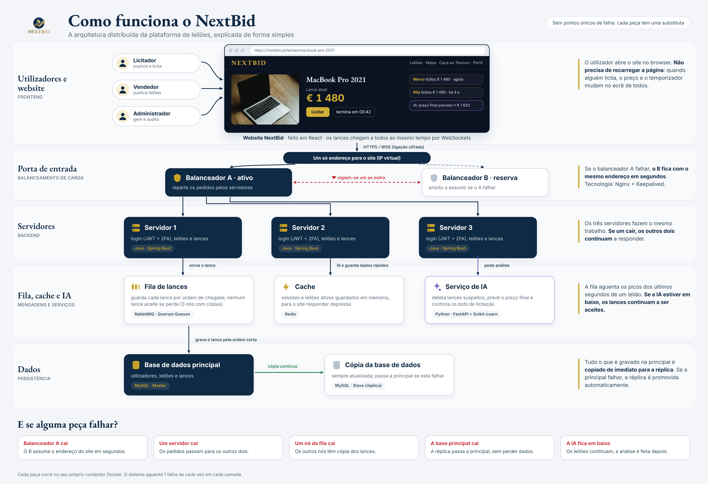
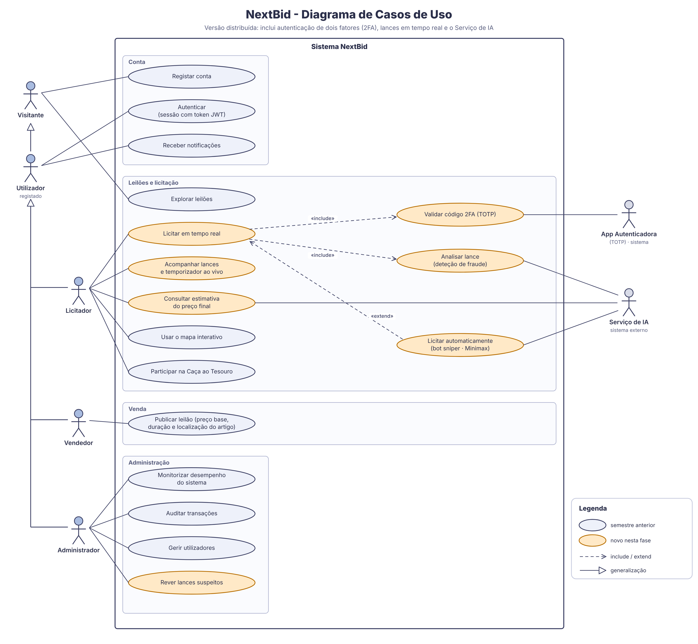

# Ficheiros Técnicos - NextBid

Esta pasta reúne os dois diagramas da 1ª entrega: a arquitetura distribuída e os casos de uso. O texto completo está no relatório do projeto.

| Ficheiro | Conteúdo |
|---|---|
| `diagramas/01_arquitetura_distribuida.pdf` | Diagrama da arquitetura distribuída |
| `diagramas/02_casos_de_uso.svg` | Diagrama de casos de uso |

As versões em PNG estão em `../02_Imagens/` (`01_arquitetura_distribuida.png` e `02_casos_de_uso_uml.png`).

---

## 1. Arquitetura distribuída

O diagrama segue o caminho de um pedido, de cima para baixo:

| Camada | O que faz | Tecnologia |
|---|---|---|
| Utilizadores e website | O licitador, o vendedor e o administrador usam o site no browser. Os lances e o temporizador atualizam-se sem recarregar a página. | React + WebSockets (WSS) |
| Porta de entrada | Dois balanceadores partilham o mesmo endereço (IP virtual). O ativo reparte os pedidos; o de reserva assume se o ativo falhar. | Nginx + Keepalived |
| Servidores | Várias instâncias iguais tratam do login (JWT + 2FA), dos leilões e dos lances. Se uma cair, as outras continuam. | Java Spring Boot |
| Fila de lances | Guarda os lances por ordem de chegada, absorve os picos dos últimos segundos e não deixa perder nenhum lance aceite. | RabbitMQ (Quorum Queues) |
| Cache | Mantém as sessões e o estado dos leilões ativos em memória. | Redis |
| Serviço de IA | Deteta lances suspeitos, estima o preço final e controla os bots de licitação. | Python (FastAPI + Scikit-Learn) |
| Dados | Base de dados principal com uma réplica sempre atualizada, que é promovida se a principal falhar. | MySQL (Master / Slave) |

Todas as peças correm em contentores Docker. O sistema foi pensado para aguentar uma falha de cada vez em cada camada sem parar o serviço.

---

## 2. Casos de uso

Atores:

- **Licitador:** explora leilões, licita em tempo real, usa o mapa interativo, participa na Caça ao Tesouro e recebe notificações.
- **Vendedor:** publica leilões e define o preço base, a duração e a localização do artigo.
- **Administrador:** monitoriza o desempenho do sistema, audita transações, gere utilizadores e revê os lances marcados como suspeitos.
- **Serviço de IA** e **App Autenticadora (TOTP):** sistemas externos que participam na licitação.

A laranja estão os casos de uso novos desta fase, ligados aos requisitos do relatório:

| Requisito | Caso de uso |
|---|---|
| RF1 - Autenticação com 2FA | `Licitar em tempo real` inclui `Validar código 2FA (TOTP)` |
| RF2 - Licitações em tempo real | `Licitar em tempo real` e `Acompanhar lances e temporizador ao vivo` |
| RF3 - Deteção de licitações fraudulentas | `Licitar em tempo real` inclui `Analisar lance`; o Administrador faz `Rever lances suspeitos` |
| RF4 - Estimativa do preço final | `Consultar estimativa do preço final` |
| Bots snipers (secção 5.1) | `Licitar automaticamente (bot sniper · Minimax)` estende `Licitar em tempo real` |

---

## 3. Índice de imagens (`02_Imagens`)

| Ficheiro | Conteúdo |
|---|---|
| 01_arquitetura_distribuida.png | Diagrama da arquitetura distribuída |
| 02_casos_de_uso_uml.png | Diagrama de casos de uso |
| DesignSystems.png | Design System do website NextBid (cores, tipografia e componentes) |
| PagHome.png | Mockup: página inicial, com a faixa de lances ao vivo |
| PagHome2.png | Mockup: leilões em curso (destaques) |
| PagLeilões.png | Mockup: todos os leilões, com pesquisa e filtro |
| PagArtigo.png | Mockup: página do leilão, com temporizador e licitação |
| PagArtigoDesc.png | Mockup: página do leilão, descrição e características |
| PagArtigoDesc2.png | Mockup: página do leilão, detalhes e última licitação |
| PagMeusLeilões.png | Mockup: os meus leilões |
| PagPerfil.png | Mockup: perfil e carteira |
| PagStats.png | Mockup: perfil, atividade recente e conquistas |
| PagPerfil2.png | Mockup: perfil com o menu do utilizador aberto |
| PagTesouro.png | Mockup: Caça ao Tesouro, com mapa |

Os mockups e o Design System vêm do repositório original do NextBid (https://github.com/rodrigocanto05/NextBid).
