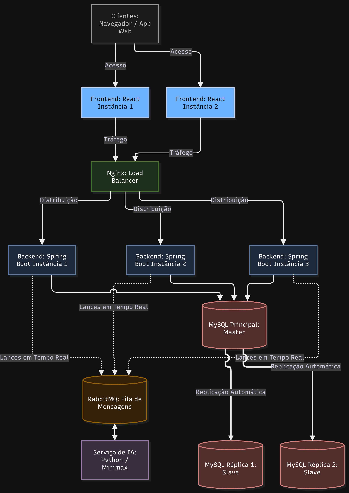
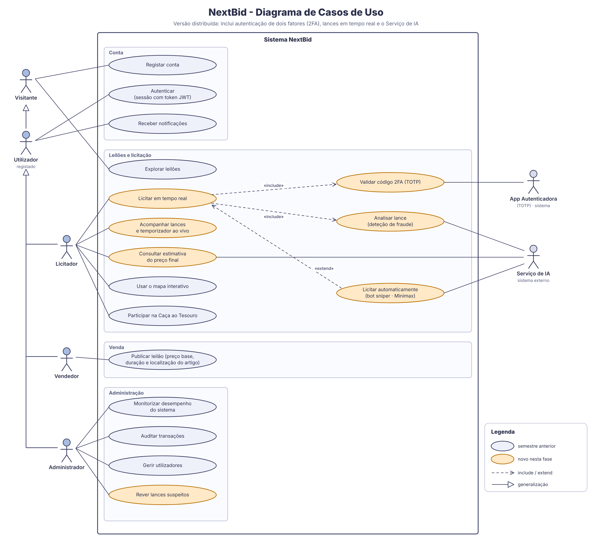

# Ficheiros Técnicos - NextBid

Esta secção documenta a arquitetura técnica e os casos de uso atualizados para a 2ª entrega do projeto (foco em sistemas distribuídos e tolerância a faltas).

| Ficheiro original (Diagramas) | Conteúdo |
|---|---|
| `diagramas/01_arquitetura_distribuida.pdf` | Diagrama da arquitetura distribuída |
| `diagramas/02_casos_de_uso.svg` | Diagrama de casos de uso |

*(Nota: As versões de alta resolução em formato PNG encontram-se na diretoria `../02_Imagens/`)*.

---

## 1. Arquitetura distribuída

Diagrama atualizado na 2.ª entrega (Node.js, PostgreSQL, RabbitMQ com *transactional outbox* e *workers*). A versão da 1.ª entrega (legado com Spring Boot e MySQL) continua referenciada no repositório para efeitos de histórico.

O diagrama reflete o fluxo de um pedido na infraestrutura distribuída, de cima para baixo:

| Camada | O que faz | Tecnologia |
|---|---|---|
| **Utilizadores e Website** | O licitador, o vendedor e o administrador acedem à plataforma no *browser*. Os lances e o temporizador atualizam-se sem necessidade de recarregar a página. | Frontend + WebSockets (WSS) |
| **Porta de Entrada (Load Balancer)** | Dois balanceadores partilham o mesmo endereço (IP virtual). O nó ativo reparte os pedidos de forma equitativa; o de reserva assume automaticamente o tráfego se o ativo falhar. | Nginx + Keepalived |
| **Servidores API** | Múltiplas instâncias idênticas processam o *login* (JWT + 2FA), a criação de leilões e os lances. O sistema garante tolerância a faltas: se uma instância cair, as restantes assumem a carga. | Node.js (Express) |
| **Fila de Eventos (Mensageria)** | Após o lance ser confirmado na base de dados, o evento segue para os *workers* assíncronos que enviam notificações, atribuem XP e atualizam o chat. Os lances não ficam à espera deste processo. Padrão *Outbox*: nenhum evento se perde, mesmo se o *broker* estiver inativo, ficando guardado na base de dados até poder ser publicado. | RabbitMQ (*Quorum Queues*) + *Workers* Node.js |
| **Tempo Real** | Distribui eventos imediatos (novo lance, fim do leilão, mensagens) de uma instância da API para as restantes, garantindo que todos os *browsers* são notificados em tempo real (não guarda dados persistentes). | Redis + Socket.IO |
| **Serviço de IA (3ª Entrega)** | Módulo para deteção de lances anómalos, previsão do preço final e mitigação de *bots* nocivos. | Python (FastAPI + Scikit-Learn) |
| **Dados** | Base de dados principal acompanhada de duas réplicas síncronas; uma réplica é promovida a nó principal em caso de falha do nó primário. Cada licitação é processada de forma síncrona e atómica. | PostgreSQL (1 Nó Principal + 2 Réplicas) |

Todas as componentes operam isoladas em contentores Docker. A infraestrutura foi desenhada propositadamente para sobreviver à falha de um nó individual em qualquer uma das camadas sem interrupção do serviço.

---

## 2. Casos de uso

**Atores:**

- **Licitador:** Explora leilões, submete licitações em tempo real, utiliza o mapa interativo e recebe notificações.
- **Vendedor:** Publica leilões e define o preço base, a duração e a localização do artigo.
- **Administrador:** Monitoriza o desempenho do sistema, audita transações, gere utilizadores e revê lances marcados como suspeitos.
- **Serviço de IA** e **App Autenticadora (TOTP):** Sistemas externos automatizados que interagem com o fluxo de autenticação e licitação.

Destacam-se os casos de uso vitais para os requisitos da nova arquitetura e próximas entregas:

| Requisito | Caso de Uso |
|---|---|
| **RF1 - Autenticação com 2FA** | `Licitar em tempo real` *inclui* `Validar código 2FA (TOTP)` |
| **RF2 - Licitações em tempo real** | `Licitar em tempo real` e `Acompanhar lances e temporizador ao vivo` |
| **RF3 - Deteção de fraudes** | `Licitar em tempo real` *inclui* `Analisar lance`; o Administrador executa `Rever lances suspeitos` |
| **RF4 - Estimativa preditiva** | `Consultar estimativa do preço final` |
| **Bots Snipers** | `Licitar automaticamente (bot sniper · Minimax)` *estende* `Licitar em tempo real` |

---

## 3. Índice de imagens (`02_Imagens`)

Todos os ficheiros de imagem encontram-se exportados na raiz da pasta `02_Imagens`.

| Ficheiro | Conteúdo / Descrição |
|---|---|
| `01_diagrama.png` | Diagrama da arquitetura distribuída |
| `02_casos_de_uso_uml.png` | Diagrama de casos de uso (UML) |
| `DesignSystems.png` | Design System do website NextBid (cores, tipografia e componentes) |
| `PagHome.png` | Mockup: Página inicial (com a faixa de lances ao vivo) |
| `PagHome2.png` | Mockup: Leilões em curso (destaques e carrossel) |
| `PagLeilões.png` | Mockup: Pesquisa global de leilões com aplicação de filtros |
| `PagArtigo.png` | Mockup: Página de leilão (temporizador em destaque e área de licitação) |
| `PagArtigoDesc.png` | Mockup: Página de leilão (zona de descrição e características do artigo) |
| `PagArtigoDesc2.png` | Mockup: Página de leilão (detalhes e histórico da última licitação) |
| `PagMeusLeilões.png` | Mockup: Os meus leilões (dashboard do utilizador) |
| `PagPerfil.png` | Mockup: Perfil público e gestão de carteira |
| `PagStats.png` | Mockup: Estatísticas, atividade recente e painel de conquistas |
| `PagPerfil2.png` | Mockup: Perfil com navegação do menu de utilizador expandido |
