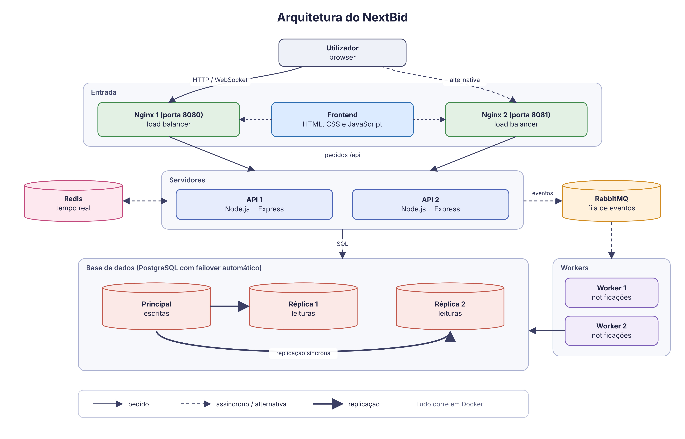
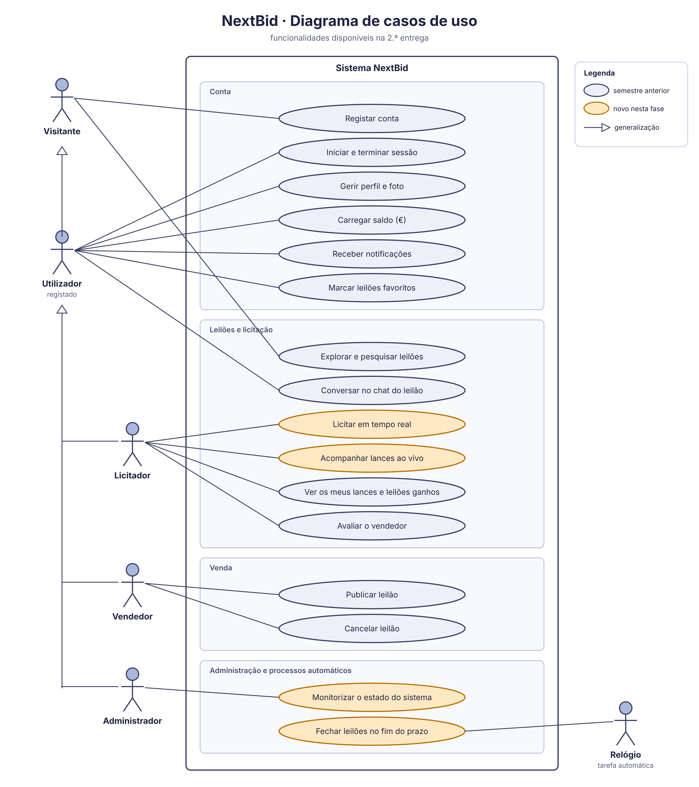
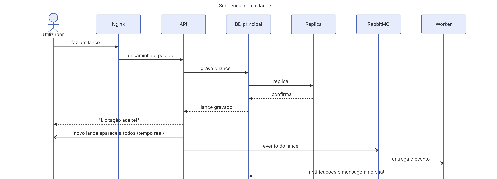
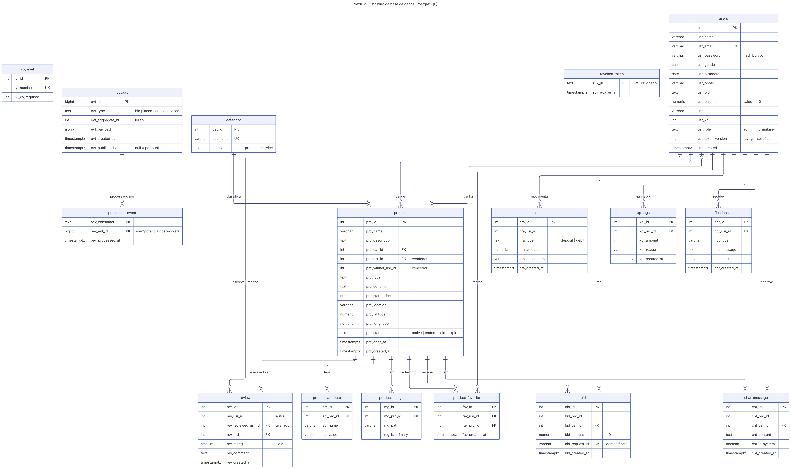

# Ficheiros Técnicos – NextBid (2.ª entrega)

Esta pasta reúne a documentação técnica do sistema: arquitetura, diagramas UML, estrutura da base de dados, capturas da aplicação e repositório Git. O modelo de faltas e os cenários de falha estão em [`modelo_de_faltas.md`](modelo_de_faltas.md).

| Ficheiro | Conteúdo |
|---|---|
| `diagramas/01_arquitetura_distribuida.svg` / `.pdf` | Arquitetura distribuída (vetorial) |
| `diagramas/02_casos_de_uso.svg` | Diagrama de casos de uso (UML) |
| `diagramas/03_estrutura_base_dados.svg` | Estrutura da base de dados |
| `diagramas/04_sequencia_lance_simples.svg` | Diagrama de sequência de um lance (UML), versão simples |
| `diagramas/05_sequencia_lance_detalhada.svg` / `.png` | Diagrama de sequência de um lance (UML), versão detalhada |
| `modelo_de_faltas.md` | Modelo de faltas e cenários de falha testados |

As versões em alta resolução (JPEG, 3000 px ou mais) estão em `../02_Imagens/`.

---

## 1. Arquitetura do sistema

| Camada | Componentes | Função |
|---|---|---|
| Entrada / cliente | 2 × Nginx (portas 8080 e 8081) | Servem o frontend e repartem os pedidos pelos servidores. Se um Nginx falhar, o site continua acessível pelo outro. |
| Frontend | HTML, CSS e JavaScript | Site de leilões. Os lances, o chat e as notificações chegam em tempo real por WebSocket (Socket.IO). |
| Servidores | 2 × API Node.js (Express) | Não guardam estado: a sessão está no token JWT, por isso qualquer servidor atende qualquer utilizador. Cada browser fica no mesmo servidor enquanto ele estiver vivo (afinidade por cookie). Um dos servidores é o líder: fecha os leilões no fim do prazo e publica os eventos. Se o líder falhar, o outro assume. |
| Tempo real | Redis | Passa os eventos de tempo real de um servidor para o outro, para que todos os browsers os recebam. |
| Mensagens | RabbitMQ | Fila `notifications` (quorum queue) com os eventos dos lances, e uma fila de mensagens falhadas (DLQ). |
| Processamento assíncrono | 2 × Worker Node.js | Tratam os efeitos de cada lance: notificações, pontos de experiência e mensagem no chat. |
| Base de dados | PostgreSQL 17 (1 principal + 2 réplicas) | Replicação síncrona: cada lance só é confirmado depois de pelo menos uma réplica o guardar. Failover automático: se o principal falhar, a réplica mais atualizada é promovida. |

Todos os componentes correm em contentores Docker (`infra/docker/docker-compose.yml`).

### Decisões principais
* **Replicação síncrona em vez de assíncrona:** preferimos perder alguns milissegundos em cada lance a arriscar perder lances já confirmados quando o principal falha. Com duas réplicas e a regra `ANY 1`, a falha de uma réplica não bloqueia as escritas.
* **Failover automático sem gestor central:** cada nó PostgreSQL tem um vigia (`infra/postgres/watchdog.sh`). Todas as réplicas aplicam a mesma regra para escolher o novo principal (a mais atualizada), por isso não é preciso um componente extra que pudesse ele próprio falhar.
* **Lance síncrono, efeitos assíncronos:** o lance precisa de resposta imediata e consistente. As notificações e o chat podem chegar um pouco depois, por isso passam pelo RabbitMQ. O evento é gravado na mesma transação do lance (padrão outbox), para não se perder se o RabbitMQ estiver em baixo.
* **Afinidade por cookie no Nginx:** cada browser fica sempre no mesmo servidor, o que torna a mudança de servidor visível e previsível nas demonstrações. Browsers diferentes continuam a ser repartidos pelos dois servidores.

---

## 2. Diagramas UML

### Casos de uso

| Ator | Casos de uso |
|---|---|
| Visitante | Registar conta; explorar e pesquisar leilões |
| Utilizador registado | Iniciar e terminar sessão; gerir perfil e foto; carregar saldo; receber notificações; marcar favoritos; conversar no chat do leilão |
| Licitador | Licitar em tempo real; acompanhar lances ao vivo; ver os seus lances e leilões ganhos; avaliar o vendedor |
| Vendedor | Publicar leilão; cancelar leilão |
| Administrador | Monitorizar o estado do sistema (página `/estado`) |
| Relógio (tarefa automática) | Fechar os leilões no fim do prazo (feito pelo servidor líder) |

### Sequência de um lance

A versão detalhada (`diagramas/05_sequencia_lance_detalhada.svg`) mostra também o bloqueio da linha do leilão, o evento gravado no outbox e a publicação feita pelo servidor líder.

---

## 3. Estrutura da base de dados

A base de dados tem 16 tabelas. As principais são `users`, `product` (leilões), `bid` (lances), `transactions` (movimentos de saldo), `chat_message` e `notifications`. Há ainda três tabelas usadas pela parte distribuída:

| Tabela | Para que serve |
|---|---|
| `outbox` | Eventos dos lances, gravados na mesma transação do lance e publicados depois no RabbitMQ. |
| `processed_event` | Eventos já tratados por cada worker. Se o RabbitMQ entregar o mesmo evento duas vezes, a segunda é ignorada. |
| `revoked_token` | Tokens JWT terminados com logout. |

O esquema completo está em `infra/postgres/init/01_schema.sql` e `infra/postgres/migrations/`.

---

## 4. Capturas da aplicação
* **Aplicação:** `../02_Imagens/img_05.jpg` a `img_13.jpg` (índice abaixo), capturas do site na versão desta entrega.
* **Testes de falha:** capturas do site e da página `/estado` antes, durante e depois de cada falha, em `../06_Dados_Investigacao/testes_de_falha/`.

---

## 5. Repositório Git
https://github.com/rodrigocanto05/NextBid-SistemasDistribuidos

O `README.md` do repositório explica como pôr o sistema a correr e como repetir os testes de falha.

---

## 6. Índice de imagens (`02_Imagens`)

| Ficheiro | Conteúdo |
|---|---|
| `img_01.jpg` | Arquitetura distribuída |
| `img_02.jpg` | Diagrama de casos de uso (UML) |
| `img_03.jpg` | Estrutura da base de dados |
| `img_04.jpg` | Diagrama de sequência de um lance (UML) |
| `img_05.jpg` | Captura: página de login |
| `img_06.jpg` | Captura: página inicial com estatísticas e leilões em destaque |
| `img_07.jpg` | Captura: lista de leilões ativos |
| `img_08.jpg` | Captura: página de um leilão (temporizador e licitação) |
| `img_09.jpg` | Captura: chat e histórico de licitações do leilão |
| `img_10.jpg` | Captura: os meus leilões |
| `img_11.jpg` | Captura: perfil, saldo e licitações do utilizador |
| `img_12.jpg` | Captura: notificações |
| `img_13.jpg` | Captura: carregar saldo |
